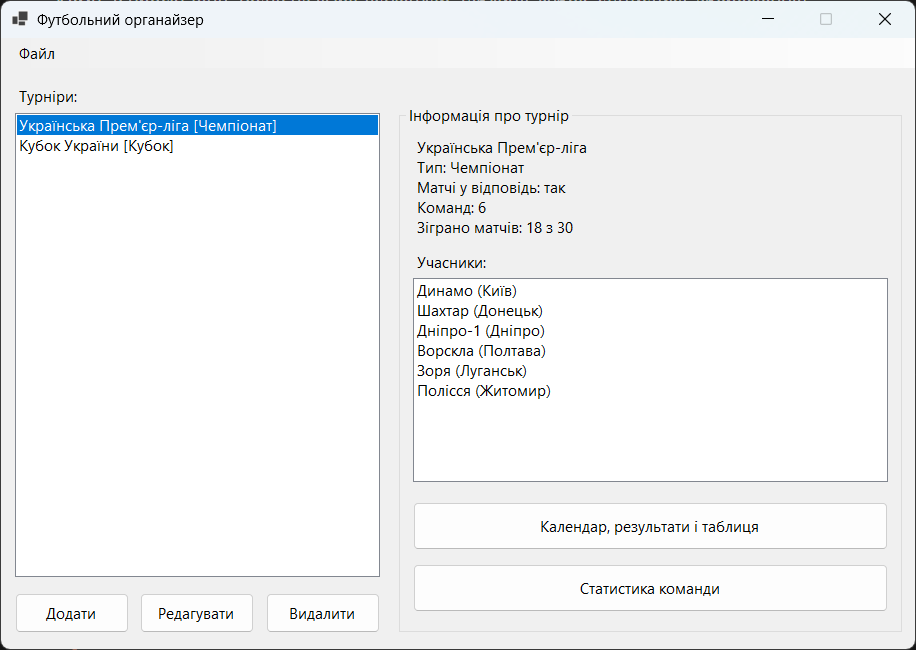
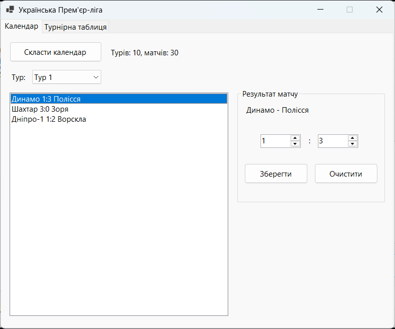
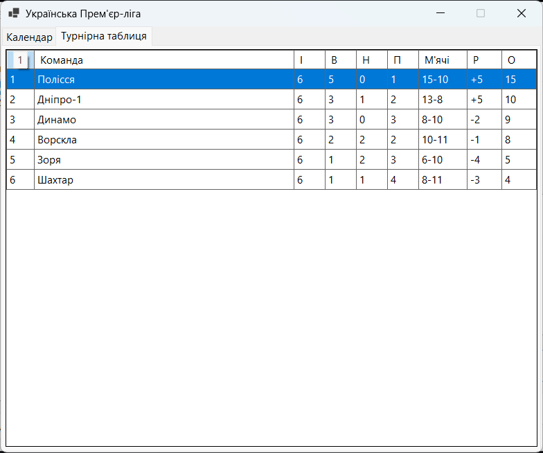
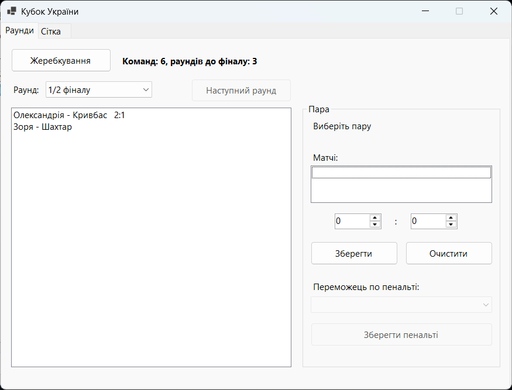
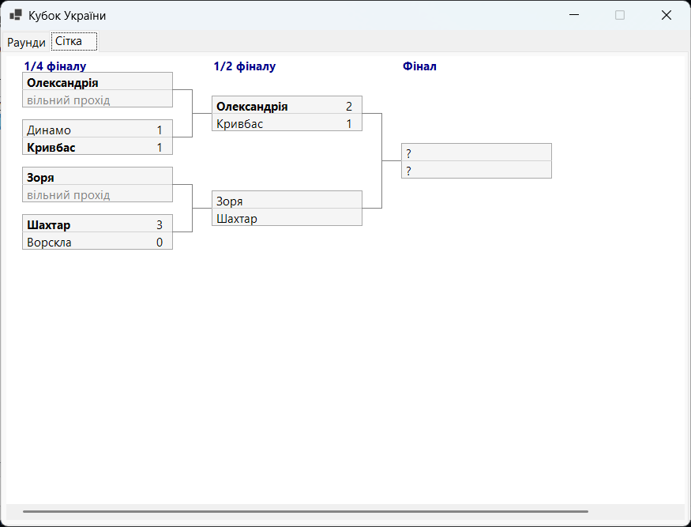
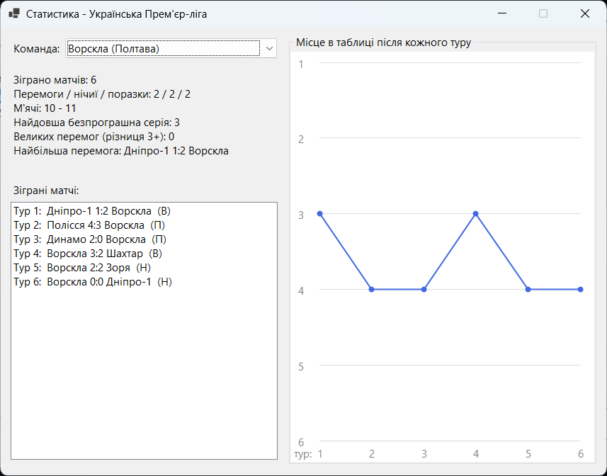

# Football Organizer

Курсова робота з дисципліни «Об'єктно-орієнтоване програмування».

Тема №21: **Футбольний органайзер — електронний довідник уболівальника.**

Програма допомагає стежити за ходом футбольних турнірів: чемпіонатів (кругова система) і кубків (олімпійська система). Можна скласти календар, вносити результати матчів, дивитись турнірну таблицю, сітку кубка і статистику команд.



## Можливості

- [x] додавання, редагування та видалення турнірів
- [x] календар турніру (чемпіонат - кругова система, кубок - олімпійська з жеребкуванням)
- [x] матчі у відповідь (за вибором)
- [x] внесення результатів матчів
- [x] турнірна таблиця
- [x] сітка кубка з вільними проходами і пенальті
- [x] статистика команди (безпрограшна серія, великі перемоги, графік місця по турах)
- [x] збереження у файл (JSON), автозбереження при виході
- [x] юніт-тести

## Скріншоти

| Календар чемпіонату | Турнірна таблиця |
|---|---|
|  |  |

| Раунди кубка | Сітка кубка |
|---|---|
|  |  |

**Статистика команди:**



## Як запустити

Потрібен Windows і [.NET 10 SDK](https://dotnet.microsoft.com/download) (або Visual Studio з робочим навантаженням «.NET desktop development»).

```
git clone https://github.com/YaroslavFedorak/football-organizer.git
cd football-organizer
dotnet run --project FootballOrganizer
```

Або відкрити `FootballOrganizer.slnx` у Visual Studio і натиснути F5.

Тести:

```
dotnet test
```

Дані зберігаються у файлі `%AppData%\FootballOrganizer\tournaments.json`. При першому запуску програма показує приклад - УПЛ і Кубок України.

## Як влаштовано

```
FootballOrganizer/
  Models/
    Team.cs          команда
    Match.cs         матч і його результат
    Tournament.cs    абстрактний турнір (спільне для чемпіонату і кубка)
    League.cs        чемпіонат: календар по круговій системі, турнірна таблиця
    Cup.cs           кубок: жеребкування, вільні проходи, раунди
    CupTie.cs        пара команд у кубку (1 або 2 матчі, пенальті)
    StandingRow.cs   рядок турнірної таблиці
    TeamStats.cs     статистика команди
  Data/
    Storage.cs       збереження і завантаження в JSON
  Forms/             вікна програми
FootballOrganizer.Tests/   юніт-тести (xUnit)
```

Календар чемпіонату складається «методом кола»: одна команда стоїть на місці, решта кожен тур зсуваються по колу. Якщо команд непарна кількість, в кожному турі одна команда відпочиває. У кубку розмір сітки - найближчий степінь двійки, зайві місця стають вільними проходами, які розподіляються по сітці рівномірно.

## Автор

Федорак Ярослав, група Д2ТН
